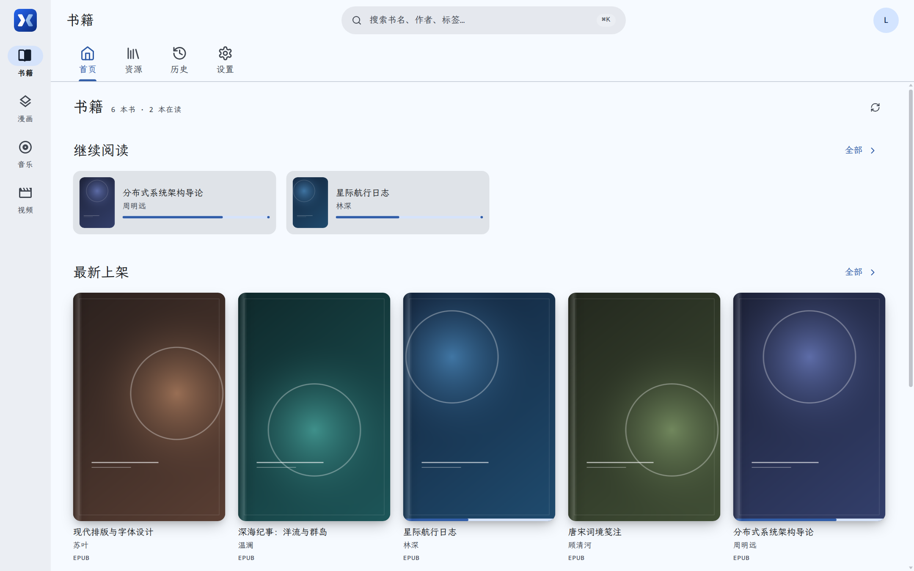
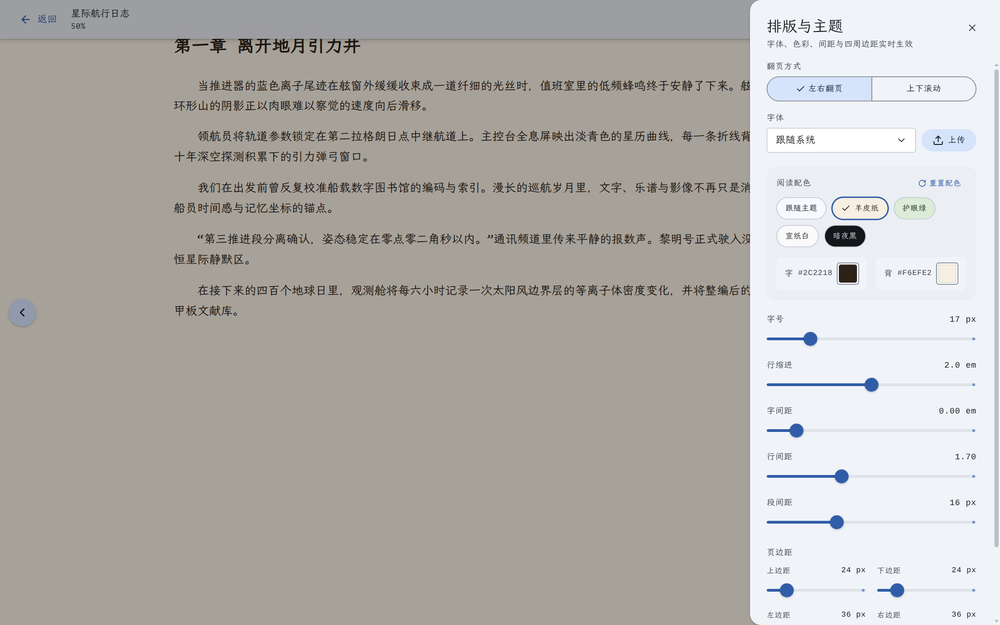
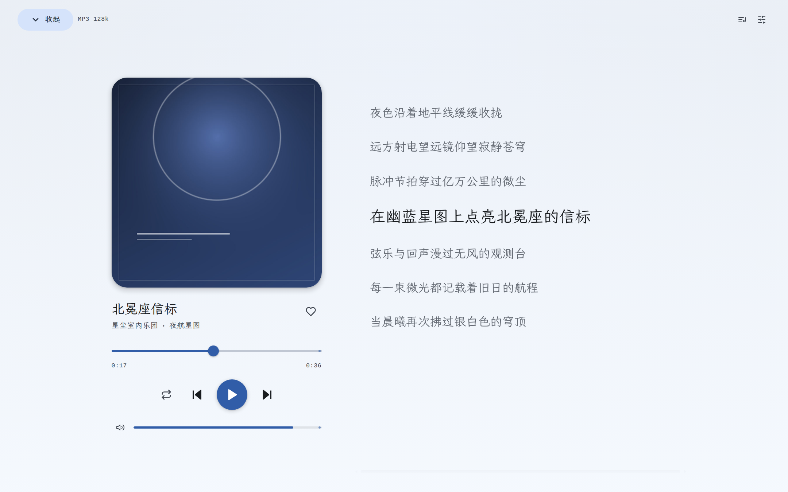
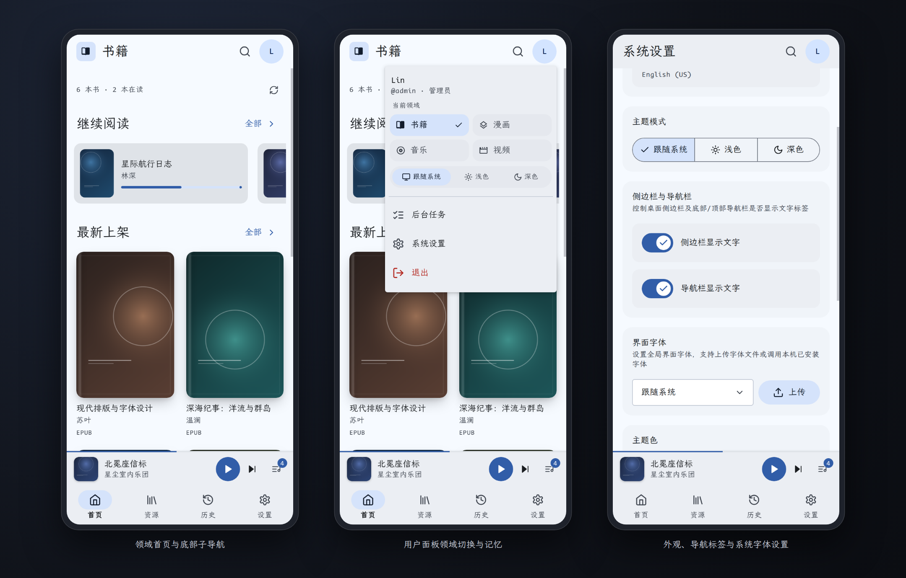
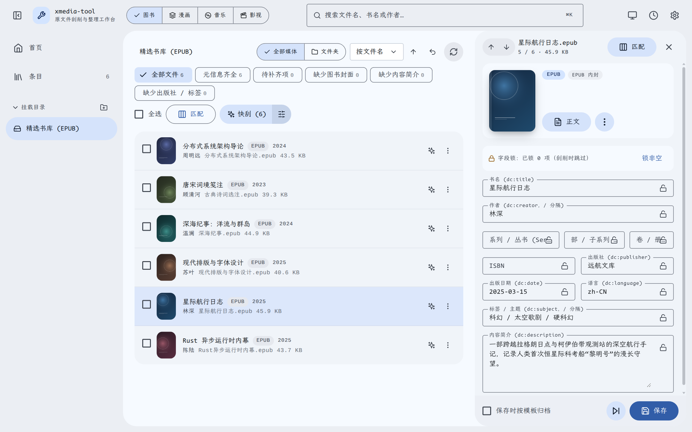

<div align="center">
  
  <h1>XMedia</h1>
  <p><strong>自托管多用户一体化数字媒体服务器与跨平台客户端</strong></p>
  <p>以单一 Rust 二进制程序、统一数据库与响应式 Material Design 3 界面，整合书籍、漫画、音乐与视频管理，同时原生兼容主流开放客户端协议。</p>

  <p>
    
    
    
    
    
  </p>

  <p>
    <a href="#核心特性">核心特性</a> ·
    <a href="#界面预览">界面预览</a> ·
    <a href="#架构概览">架构概览</a> ·
    <a href="#快速开始">快速开始</a> ·
    <a href="#配置说明">配置说明</a> ·
    <a href="#开放协议生态">开放协议生态</a>
  </p>
</div>

---

## 项目简介

传统自托管媒体方案通常需要为电子书、漫画、音乐和影视分别部署并维护多套独立服务、账号体系与数据库。**XMedia** 将四大媒体域收敛至同一套模块化 Rust 工作空间中：

- **单一服务端程序 (`xmedia-server`)**：内嵌构建后的 Web 单页应用资源，默认零外部依赖启动（SQLite 自动建表与迁移，支持按需编译启用 PostgreSQL 或 MySQL）。
- **独立原文件整理工作台 (`xmedia-tool`)**：面向本地原始媒体目录的元数据刮削、标签检视、EPUB 正文编辑与批量重命名归档工具。
- **跨平台原生客户端 (`xmedia-app`)**：基于 Tauri v2 构建桌面与 Android 客户端，内置本地离线媒体引擎与远程服务器网关（原生支持连接 XMedia、OPDS 与 OpenSubsonic 服务）。

---

## 界面预览

### 统一媒体工作区

桌面端采用自适应侧边导航栏与领域子导航结构，聚合跨源继续阅读架、最新入库海报墙与全局快捷检索。

<p align="center">
  
</p>

### 沉浸式阅读排版与逐行同步歌词

阅读器支持字体选择与上传、预设及自定义文字与背景配色、字号、首行缩进、字间距、行间距、段间距与四周边距实时调节；音乐播放器支持内嵌与外挂多编码 LRC 逐行同步高亮。

<table>
  <tr>
    <td width="50%">
      
      <p align="center"><sub>电子书阅读器：预设配色与全维度间距实时调节</sub></p>
    </td>
    <td width="50%">
      
      <p align="center"><sub>音乐播放器：专辑封面渲染与逐行同步歌词</sub></p>
    </td>
  </tr>
</table>

### 移动端自适应导航与个性化外观

移动端采用底部当前领域子导航栏（首页、资源、历史、设置），通过右上角用户面板集中切换并持久记忆当前所在媒体域；支持侧边栏与导航栏文字显隐控制，并在 Android 客户端原生桥接系统默认字体与沉浸式安全区。

<p align="center">
  
</p>

### 原文件刮削与整理工作台 (`xmedia-tool`)

提供非侵入式本地目录挂载、缺失字段筛选、批量自动匹配刮削、字段级加锁保护、EPUB 内部章节编辑及模板化归档重命名。

<p align="center">
  
</p>

---

## 核心特性

| 模块 | 主要能力 |
| --- | --- |
| **电子书 (`book`)** | 解析 EPUB、PDF、TXT（支持智能分章与多编码识别）；精细化阅读排版与自定义字体上传；跨设备阅读进度与书签同步；支持在线书源检索、缓存追踪与换源；提供 OPDS 1.2 与 OPDS 2.0 订阅源。 |
| **漫画 (`comic`)** | 支持 CBZ、ZIP、EPUB 及图片目录扫描；解析 `ComicInfo.xml` 系列与卷册元数据；支持双页拼接、条漫滚动与阅读方向切换；内置 WebP 缩略图缓存、ETag/304 协商与 OPDS PSE 1.1 页流扩展。 |
| **音乐 (`music`)** | 基于 Lofty 提取 FLAC、MP3、M4A、OGG、OPUS、WAV 标签、内嵌封面与 ReplayGain；支持 SYLT 与多编码 LRC 歌词解析；支持 FFmpeg 流式转码、HTTP Range 分段传输与 OpenSubsonic 1.16.1 接口。 |
| **视频 (`video`)** | 基于 FFprobe 探测多音轨、内封字幕与章节信息；支持直通流式播放与 fMP4 智能重封装或按需转码；自动将 SRT / ASS 字幕转换为 WebVTT；兼容 Jellyfin 客户端协议。 |
| **多用户与权限** | 共享资源池（Pool）与个人媒体库绑定隔离；各用户阅读进度、播放记录、收藏书架、热力图统计与界面偏好完全独立；支持 Cookie、Bearer JWT、HTTP Basic、API Key 与 Subsonic 令牌认证。 |
| **在线源引擎 (`source`)** | 内置统一规则解析引擎（CSS 选择器、JSONPath、正则替换、Mustache 模板与沙箱化 QuickJS 脚本），具备并发限流与私有地址 SSRF 防护。 |
| **个性化与多端体验** | 基于 Material Design 3 动态色彩生成算法；支持自定义主题种子色、界面字体（跟随系统原生字体、本机已安装字体枚举、自定义字体上传）及导航文字标签开关。 |

---

## 架构概览

项目按领域驱动边界拆分为独立的 Rust Crate 与前端单页应用，支持通过 Cargo Features 按需裁剪编译目标：

```text
xmedia/
├── crates/
│   ├── xmedia-formats/ # 纯粹底层容器格式读写（EPUB/OPF/NCX、CBZ/ComicInfo、音频标签、NFO）
│   ├── xmedia-core/    # 核心领域模型：多方式鉴权、媒体库与资源池、在线条目、活动统计、字体与流式基础设施
│   ├── xmedia-source/  # 通用在线源规则引擎：HTTP/SSRF 防护、CSS/JSONPath 解析、QuickJS 沙箱与并发调度
│   ├── xmedia-book/    # 书籍域：EPUB/PDF/TXT 解析、书架与阅读进度持久化、REST API 与 OPDS 1.2 / 2.0
│   ├── xmedia-comic/   # 漫画域：系列扫描器、页面流缓存、阅读进度追踪、REST API 与 OPDS PSE 1.1
│   ├── xmedia-music/   # 音乐域：无损音频元数据、混合歌词解析器、FFmpeg 音频管道与 OpenSubsonic 1.16.1
│   ├── xmedia-video/   # 视频域：FFprobe 多流探测、fMP4 智能重封装/转码、字幕转换与 Jellyfin 兼容层
│   ├── xmedia-tool/    # 独立原文件元数据刮削、检视、EPUB 正文编辑与批量重命名服务端
│   └── xmedia/         # 统一 HTTP 网关、特性开关装配、rust-embed 前端资源托管与 xmedia-server 入口
├── apps/
│   └── xmedia-app/     # Tauri v2 跨平台桌面与 Android 客户端（内嵌离线媒体引擎、远程协议网关与原生字体桥接）
├── web/                # Vue 3 + TypeScript + Tailwind CSS v4 前端工程（主工作区 SPA 与 xmedia-tool 工作台 SPA）
└── e2e/                # 零第三方 npm 依赖的 Node.js 全链路 API 与 Chromium CDP 端到端测试套件
```

---

## 快速开始

### 环境要求

- **Rust**：1.85+（支持 Rust 2024 Edition）
- **Node.js & pnpm**：Node.js 20+，pnpm 9+（仅从源码构建前端时需要）
- **FFmpeg / FFprobe**（可选，推荐安装）：用于音乐流式转码及视频流信息探测、重封装与字幕提取

### 从源码构建并运行

```bash
# 1. 安装前端依赖并构建主工作区与工具台静态资源
pnpm --dir web install
pnpm --dir web run build
pnpm --dir web run build:tool

# 2. 编译服务端与元数据整理工作台（自动通过 rust-embed 内嵌前端产物）
cargo build --release -p xmedia -p xmedia-tool

# 3. 启动主媒体服务器（默认监听 http://0.0.0.0:8090，数据与 SQLite 存储于 ./data）
./target/release/xmedia-server
```

首次访问 `http://127.0.0.1:8090` 时，系统会自动进入三步初始化向导，完成管理员账号创建、首个媒体目录挂载与后台扫描。

### 启动原文件刮削工作台 (`xmedia-tool`)

```bash
# 默认仅监听本地回环地址 http://127.0.0.1:8091，可通过 --root 预挂载多个媒体目录
./target/release/xmedia-tool --root /path/to/books --root /path/to/music
```

> 安全约束：当 `--bind` 指定非本地回环地址（如 `0.0.0.0:8091`）时，`xmedia-tool` 强制要求配置 `--password`（或 `XMEDIA_TOOL_PASSWORD`）方可启动。

### 按需裁剪编译特性

`xmedia` 默认启用全部四个媒体域（`book`、`comic`、`music`、`video`）与内置 SQLite。你可以根据硬件与场景按需裁剪：

```bash
# 仅编译书籍与音乐模块（适合轻量级阅读与听歌服务）
cargo build --release -p xmedia --no-default-features --features book,music

# 启用外部 PostgreSQL 或 MySQL 存储后端支持
cargo build --release -p xmedia --features db-postgres
cargo build --release -p xmedia --features db-mysql
```

### 构建桌面与 Android 客户端 (`xmedia-app`)

```bash
# 构建桌面端安装包（Linux / macOS / Windows）
cd apps/xmedia-app
cargo tauri build

# 构建 Android 客户端 APK（需配置 Android SDK 与 NDK 环境）
cargo tauri android build
```

---

## 配置说明

### `xmedia-server` 参数与环境变量

| 命令行参数 | 环境变量 | 默认值 | 说明 |
| --- | --- | --- | --- |
| `--bind` | `XMEDIA_BIND` | `0.0.0.0:8090` | HTTP 服务监听地址与端口 |
| `--data-dir` | `XMEDIA_DATA_DIR` | `./data` | 托管上传文件、封面缩略图缓存、自定义字体及默认 SQLite 目录 |
| `--database-url` | `XMEDIA_DATABASE_URL` | `sqlite:<data_dir>/xmedia.db` | 数据库连接串；使用 `postgresql://` 或 `mysql://` 需开启对应编译特性 |
| `--secret` | `XMEDIA_SECRET` | 自动生成并持久化 | JWT 签名与 Subsonic 凭据主密钥；未指定时自动生成 256 位随机密钥存于 `<data_dir>/.secret` |
| `--jwt-ttl-secs` | `XMEDIA_JWT_TTL_SECS` | `604800` | Web 登录会话令牌有效期（秒，默认 7 天） |
| `--ffmpeg-bin` | `XMEDIA_FFMPEG_BIN` | `ffmpeg` | `ffmpeg` 可执行文件路径（自动在同目录探测 `ffprobe`） |
| `--web-dir` | `XMEDIA_WEB_DIR` | 无（使用内嵌资源） | 指定外部前端构建目录以覆盖二进制内嵌静态资源 |
| `--cors-allow-origin` | `XMEDIA_CORS_ALLOW_ORIGINS` | 仅同源请求 | 显式允许的跨域来源列表（支持重复传参或逗号分隔） |

### `xmedia-tool` 参数与环境变量

| 命令行参数 | 环境变量 | 默认值 | 说明 |
| --- | --- | --- | --- |
| `--bind` | `XMEDIA_TOOL_BIND` | `127.0.0.1:8091` | 工作台监听地址（默认仅监听本地回环接口） |
| `--data-dir` | `XMEDIA_TOOL_DATA_DIR` | `./data-tool` | 工作台配置文件（挂载目录、刮削器密钥与重命名模板）存储路径 |
| `--root <DIR>` | 无 | 空 | 启动时预注册的白名单媒体根目录，可多次传入 |
| `--lock-roots` | `XMEDIA_TOOL_LOCK_ROOTS` | `false` | 锁定挂载目录列表，禁止在运行期通过 Web API 新增或移除目录 |
| `--password` | `XMEDIA_TOOL_PASSWORD` | 无 | Web 工作台访问口令（监听非回环地址时必填） |
| `--ffmpeg-bin` | `XMEDIA_TOOL_FFMPEG_BIN` | `ffmpeg` | 用于视频流探测的 `ffmpeg` 路径 |
| `--web-dir` | `XMEDIA_TOOL_WEB_DIR` | 无（使用内嵌资源） | 覆盖内嵌的 `web/dist-tool` 静态资源目录 |
| `--cors-allow-origin` | `XMEDIA_TOOL_CORS_ALLOW_ORIGINS` | 仅同源请求 | 显式允许的跨域来源列表 |

---

## 开放协议生态

XMedia 在提供统一 Web 界面的同时，为各媒体域内置了标准化第三方客户端协议端点，具体完整地址也可在各领域设置页的「开放协议」面板中一键复制：

| 媒体域 | 协议标准 | 挂载端点 | 推荐兼容客户端 |
| --- | --- | --- | --- |
| **书籍** | OPDS 1.2 (Atom XML) | `http://<host>:8090/opds/book/v1.2` | KOReader, Foliate, Moon+ Reader, Cantook |
| **书籍** | OPDS 2.0 (JSON) | `http://<host>:8090/opds/book/v2` | Thorium Reader, Cantook, XMedia App |
| **漫画** | OPDS 1.2 + PSE 1.1 | `http://<host>:8090/opds/comic/v1.2` | Panels, Mihon (OPDS), Chunky, KOReader |
| **音乐** | OpenSubsonic 1.16.1 | `http://<host>:8090`（自动挂载 `/rest/*`） | Symfonium, Feishin, Supersonic, Amperfy |
| **视频** | Jellyfin 兼容 API | `http://<host>:8090/jellyfin` | Infuse, Swiftfin, SenPlayer, VidHub |

---

## 开发与测试验证

代码库包含完整的单元、集成与端到端验证流水线：

```bash
# Rust 代码格式检查、Clippy 静态分析与工作空间测试
cargo fmt --all -- --check
cargo clippy --workspace --all-targets -- -D warnings
cargo test --workspace

# 前端 TypeScript 类型检查与双入口生产构建校验
pnpm --dir web run typecheck
pnpm --dir web run build
pnpm --dir web run build:tool

# 运行端到端测试套件（自检与分层测试）
node e2e/run.mjs --self-test
node e2e/run.mjs --tier 1
```

---

## 许可证

本项目基于 [MIT License](LICENSE) 开源发布。
